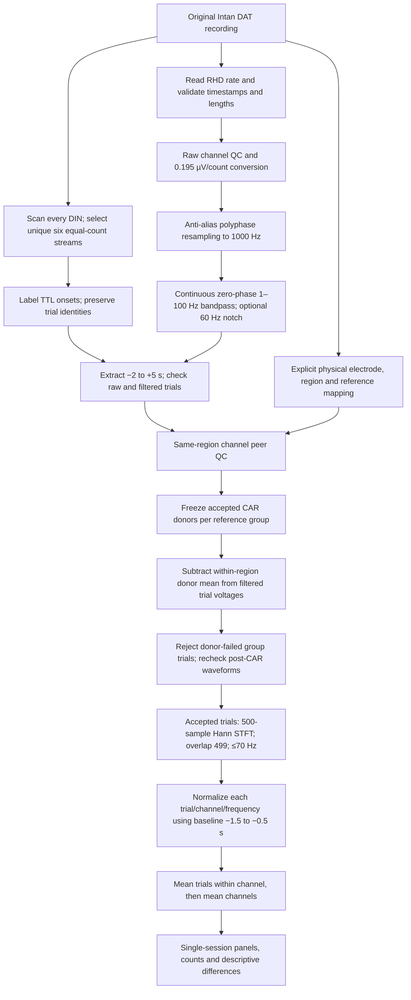

# Differential inter-cortical coupling in orthonasal and retronasal processing

Figure-first manuscript repository. GC = gustatory cortex; PC = posterior piriform cortex.
Each figure has a panel contract; reusable processing lives in `src/coupling`.
No legacy scripts or recordings are changed. No study outcomes are assumed.

## Start here

1. Read `docs/figure_plan.md` and the panel contracts in `figures/`.
2. Read `docs/data_contract.md` before preparing any session.
3. Follow `docs/lfp_roadmap.md`: Fig 6A quality control, Fig 6B power context,
   then Fig 6C coherence and Fig 6D Granger.

## Directory organization

| Directory | Purpose |
|---|---|
| `figures/fig01_delivery_alignment/` | Delivery and alignment validation |
| `figures/fig02_recording_validation/` | Simultaneous GC/PC, breathing, representative LFPs |
| `figures/fig03_pc_reliability/` | PC response fractions, latency, locking, split-half |
| `figures/fig04_pc_route_dynamics/` | Matched odors, temporal shifts, population dynamics |
| `figures/fig05_gc_dynamics/` | GC responses and three-phase hypothesis |
| `figures/fig06_lfp_coupling/` | QC, power, coherence, directional analyses — FIRST |
| `figures/fig07_transition_coupling/` | Coupling of inferred population transitions |
| `figures/fig08_spike_coupling/` | Noise correlations, cross-correlations, Poisson GLMs |
| `src/coupling/` | Shared tested computations |
| `configs/` | Session/analysis configuration |
| `scripts/` | Small entry points and synthetic demo |
| `tests/` | Numerical and input-contract tests |
| `docs/` | Methods decisions, data contracts, build order |

`data/` and `results/` are ignored by Git. Keep actual recordings outside this repo.
See `docs/github_setup.md` for creating the private remote repository.


## Copy-paste: process one complete session

Use the PyCharm terminal from the repository root, with the project's Python
interpreter active (Python 3.10+). PRs #1 and #2 are merged into `master`.
If Git reports local changes that prevent switching, preserve them before proceeding.

```bash
git status --short
git fetch origin
git switch master
git pull --ff-only origin master
python -m pip install -e .
python -m unittest discover -s tests -v
```

**Verify the session-specific mapping before processing.** The example explicitly
maps `amp-C-000.dat`–`amp-C-031.dat` to GC and `amp-C-032.dat`–`amp-C-063.dat` to
PC (posterior piriform). Filenames, anatomical assignments, raw sample rate and
stimulus labels must match the actual recording. Do not infer anatomy from retained
channels or spike-sorting yield. Confirm dysgranular insular/pPC placement from
recording records and histology; code labels do not establish placement.

For the confirmed TG22 Feb2 session, paste this block:

```bash
SESSION="/media/thomas/Data/TG22/Feb2_OrthoRetro_TG22_260202_170014"
CONFIG="configs/tg22_feb2.example.json"
RUN="$PWD/results/TG22_Feb2_$(date +%Y%m%d_%H%M%S)"
export RUN
coupling-scan-dins "$SESSION" "${RUN}_din_scan"
```

Expected: DINs **0–5 each have 30 trials**, selected as the unique group of exactly
six equal-count inputs; DINs 6–7 each have 90 pulses and are excluded. Ambiguity,
unequal counts, malformed pulses or label mismatches stop the pipeline. Trials are
never truncated to force agreement.

| DIN | Label | Delivery |
|---|---|---|
| 0 | BA | Intraoral/retronasal odor |
| 1 | S | Intraoral sucrose |
| 2 | oIA | Orthonasal odor |
| 3 | IA | Intraoral/retronasal odor |
| 4 | oBA | Orthonasal odor |
| 5 | BK | Orthonasal blank/control |

Once mapping and scan are confirmed, paste:

```bash
coupling-prepare "$SESSION" "$CONFIG" "$RUN" --plot-power
```

This creates QC tables/plots, preprocessing provenance, cleaned arrays, and
12 region/stimulus power panels under `$RUN/power`. Outputs must be **new folders
outside the recording folder**. Source DAT files and existing blech_clust outputs
are never rewritten. No spike sorting is required. ADC nasal pressure and VDD
streams are not consumed in this TTL-aligned power stage.

## Copy-paste: compare existing power panels

These commands reuse saved normalized arrays; they do not repeat raw processing.
If the terminal above is still open, `$RUN` is already set. In a new terminal,
locate and explicitly select the completed processing folder:

```bash
ls -d "$PWD"/results/TG22_Feb2_*
read -r -e -p "Paste the full completed processing folder path: " RUN
export RUN
```

The chosen folder must contain `power/session_power.npz`; choose the processing
folder, not a folder ending in `_din_scan`. Set the input and a fresh figure folder:

```bash
POWER="$RUN/power/session_power.npz"
FIGURES="$PWD/results/sample_comparisons_$(date +%Y%m%d_%H%M%S)"
```

Matched IA route comparison in each region:

```bash
coupling-compare-power "$POWER" "$FIGURES/GC_IA_vs_oIA" --left GC:IA --right GC:oIA
coupling-compare-power "$POWER" "$FIGURES/PC_IA_vs_oIA" --left PC:IA --right PC:oIA
```

Matched BA route comparison in each region:

```bash
coupling-compare-power "$POWER" "$FIGURES/GC_BA_vs_oBA" --left GC:BA --right GC:oBA
coupling-compare-power "$POWER" "$FIGURES/PC_BA_vs_oBA" --left PC:BA --right PC:oBA
```

Taste responses across regions and an orthonasal odor versus blank:

```bash
coupling-compare-power "$POWER" "$FIGURES/sucrose_GC_vs_PC" --left GC:S --right PC:S
coupling-compare-power "$POWER" "$FIGURES/PC_oIA_vs_blank" --left PC:oIA --right PC:BK
```

Optional third panel: **left minus right**, with a diverging color scale:

```bash
coupling-compare-power "$POWER" "$FIGURES/GC_IA_difference" --left GC:IA --right GC:oIA --difference --difference-clim 1
```

Outputs include `comparison.png` (600 dpi), `comparison.pdf`, `comparison.svg`
(editable text with rasterized heatmaps), `caption.txt`, numerical arrays/counts
and provenance. Source panels share turbo and symmetric ±3 z limits. `--clim 2`
changes both together; it is a display change, not renormalization. Color limits
can clip extremes; retain the numerical arrays and disclose display limits.
Use a new output folder each time. See [comparison details](docs/power_comparison.md).

## What the pipeline actually does



The continuous filter is fourth-order Butterworth, applied forward/backward;
the optional notch is 60 Hz with Q=30 and is enabled in the example. Resampling
uses 30 s chunks with 1 s FIR context. CAR is performed on filtered trial voltages
using fixed donors; identical linear filtering makes this equivalent to
referencing before filtering for those fixed members. It is arithmetic mean CAR,
**not** blech_clust's median/MAD-normalized reference. Power is calculated on each
referenced channel, not on a region-averaged voltage trace.

Normalization is a **baseline power z-score**, independently for every
trial/channel/frequency, before either averaging step. Zero/near-zero baseline
variance produces missing values; it is not replaced with a zero response.
The baseline is provisional. STFT centers are displayed from −1000 to +1750 ms;
the post frequency summary uses +250 to +1750 ms. A 1 ms hop is a dense plotting
grid, **not 1 ms temporal resolution**: each estimate spans 500 ms. The 0 Hz bin
is not evidence of a physiological DC rhythm after high-pass filtering. The
60 Hz notch affects interpretation of nearby high-frequency power.

## Single-session QC: implementation and literature-informed review

**The papers below motivate biological checks and comparisons; they do not
validate our numerical rejection thresholds, CAR choice, or normalization.**
Current cutoffs are explicit provisional engineering rules. Do not loosen them
just to retain more electrodes or make a plot look like a published figure.

| Implemented check | Rule / output to inspect |
|---|---|
| Input integrity | Consecutive timestamps, sample-rate agreement, equal amplifier/DIN lengths, binary complete DIN pulses; stop on failure. |
| Waveform quality | Finite, nonconstant, nonzero MAD; sustained identical runs ≥10 ms fail if their fraction exceeds 1%; robust outlier score `abs(x−median)/(1.4826×MAD)>10` fails if its fraction exceeds 1%. Inspect raw and filtered metrics. |
| Same-region peer QC | Leave-one-out comparison of median, SD and initial bad-trial fraction; deviation >3 scaled MAD fails. At least three usable peers required. If peer MAD is zero, unequal values fail. This can exclude channels for small differences; inspect actual values. |
| CAR membership | Fixed accepted donors, ≥3 per reference group, no mixing regions. Inspect `preprocessing.json` → `reference.members`. Any initial donor-trial failure rejects that event for the reference group. |
| Final retention | Post-CAR waveform recheck can reject individual channel/trials. Inspect `trial_qc.csv`, retention plots and contributing channel counts. Exclusion rates must be reported by condition, not hidden. |
| Artifact spreading | Review raw/unreferenced/referenced traces near movement, valve transitions and dropouts. Zero-phase filters and the STFT spread transients in time; artifact-interval dilation has not been validated. |

Copy-paste a compact QC summary (uses the selected `$RUN`):

```bash
python - <<'PY'
import csv, json, os
from collections import Counter
from pathlib import Path
run = Path(os.environ['RUN'])
channels = list(csv.DictReader((run/'channel_qc.csv').open()))
trials = list(csv.DictReader((run/'trial_qc.csv').open()))
events = {r['event_id']: r for r in csv.DictReader((run/'events.csv').open())}
for region in ('GC', 'PC'):
    rows = [r for r in channels if r['region'] == region]
    good = {r['electrode_id'] for r in rows if r['good_channel'] == 'True'}
    print(region, 'accepted channels:', len(good), '/', len(rows))
    print('Exclusion reasons:', dict(Counter(r['reasons'] for r in rows if r['good_channel'] != 'True')))
    for stimulus in ('BA', 'IA', 'S', 'oBA', 'oIA', 'BK'):
        accepted = [r for r in trials if r['electrode_id'] in good
                    and events[r['event_id']]['stimulus'] == stimulus
                    and r['accepted'] == 'True']
        counts = Counter(r['electrode_id'] for r in accepted)
        values = [counts[e] for e in good]
        print(stimulus, 'accepted trials/channel:',
              (min(values), max(values)) if values else 'no accepted channels')
print('Reference:', json.loads((run/'preprocessing.json').read_text())['reference'])
PY
```

### Reviews motivated by rat taste/odor physiology

The following are **recommended reviews**, not additional automated tests already
implemented by the power/compare commands.

| Review or comparison | Literature rationale and single-session interpretation |
|---|---|
| Early versus later 7–12 Hz dynamics in GC | Tort et al. [1] reported early ∼11 Hz and later ∼7 Hz taste rhythms. Inspect time-resolved power rather than treating the entire band as one process. Our 2 Hz frequency grid and 500 ms window limit precise transition estimates. |
| Prestimulus state and session progression | Fontanini & Katz [2] associated spontaneous 7–12 Hz activity with disengagement. Inspect whether baseline rhythms or response sizes drift across early/late trials; an increase in this band is not automatically taste coding. |
| TTL versus respiratory timing | Samuelsen & Fontanini [3] related GC intraoral odor responses to exhalation and distinguished an early oral component. TTL alignment is not measured odor arrival. Inspect respiration/behavior before claiming route latency differences; ADC alignment remains future work. |
| Oral delivery controls | Maier [4] found odor, taste and oral somatosensory responses in both cortices. Separate odor-associated responses from fluid delivery/mouth movements. This six-DIN session has no separately labeled intraoral water condition; sucrose is not a water control and orthonasal BK is not an intraoral fluid control. |
| Taste responses in pPC | Maier, Wachowiak & Katz [5] demonstrated taste-responsive pPC neurons and contrasted their respiratory relationship with odor responses. A pPC sucrose response is biologically plausible; single-neuron evidence does not establish the source of a particular LFP component. |
| Reference sensitivity and trial consistency | Compare CAR with a deliberately unreferenced run; inspect individual channels/trials and early/late or split-half patterns. This is our methodological sensitivity recommendation, not a threshold prescribed by [1–5]. Neighboring channels and repeated trials are not independent animals. |

### Comparisons appropriate for a sample figure

- **BA versus oBA and IA versus oIA within each region:** matched odor route
  contrasts. Describe fluid delivery, stimulus duration, respiratory timing and
  behavior as possible contributors; route is not isolated by this contrast alone.
- **oBA or oIA versus BK within a region:** orthonasal odor versus blank, provided
  the delivery records confirm that BK is the appropriate matched blank.
- **GC versus pPC for the same stimulus:** standardized response patterns. Since
  each channel/trial has its own baseline mean/SD, larger z-scores do not imply
  larger absolute voltage power in one region.
- **Early/later windows or trial splits:** useful stability/state checks, but the
  current comparison command selects region/stimulus panels only; it does not
  calculate trial splits, confidence intervals or hypothesis tests.

A difference panel is subtraction of normalized session means, not a paired-trial
statistical test. Do not put significance stars on these descriptive panels.
This is **one animal and one session**, regardless of electrode/trial counts.
Power changes do not demonstrate GC–pPC coupling, directionality, taste selectivity
or odor specificity. Coherence, Granger, respiration alignment and multi-session
animal-level inference remain later stages.

### Primary references

1. Tort ABL, Fontanini A, Kramer MA, Jones-Lush LM, Kopell NJ, Katz DB (2010).
   *Cortical Networks Produce Three Distinct 7–12 Hz Rhythms during Single Sensory
   Responses in the Awake Rat.* Journal of Neuroscience 30:4315–4324.
   [doi:10.1523/JNEUROSCI.6051-09.2010](https://doi.org/10.1523/JNEUROSCI.6051-09.2010).
2. Fontanini A, Katz DB (2005). *7 to 12 Hz activity in rat gustatory cortex reflects
   disengagement from a fluid self-administration task.* Journal of Neurophysiology
   93:2832–2840. [doi:10.1152/jn.01035.2004](https://doi.org/10.1152/jn.01035.2004).
3. Samuelsen CL, Fontanini A (2017). *Processing of Intraoral Olfactory and Gustatory
   Signals in the Gustatory Cortex of Awake Rats.* Journal of Neuroscience
   37:244–257. [doi:10.1523/JNEUROSCI.1926-16.2016](https://doi.org/10.1523/JNEUROSCI.1926-16.2016).
4. Maier JX (2017). *Single-neuron responses to intraoral delivery of odor solutions
   in primary olfactory and gustatory cortex.* Journal of Neurophysiology
   117:1293–1304. [doi:10.1152/jn.00802.2016](https://doi.org/10.1152/jn.00802.2016).
5. Maier JX, Wachowiak M, Katz DB (2012). *Chemosensory convergence on primary
   olfactory cortex.* Journal of Neuroscience 32:17037–17047.
   [doi:10.1523/JNEUROSCI.3540-12.2012](https://doi.org/10.1523/JNEUROSCI.3540-12.2012).

## Validation and next steps

All 13 unit tests passed at the comparison implementation. A complete TG22 Feb2
biological session produced power outputs with 23 GC and 15 PC retained channels,
and representative comparison exports were inspected. This is a successful
execution, **not completed biological validation**: mapping/histology, exclusion
rationale, CAR sensitivity and artifact propagation still need review. See
[raw processing](docs/raw_processing.md), [validation](docs/validation.md),
[comparison details](docs/power_comparison.md) and the [continuation prompt](docs/continue_prompt.md).

## Delivery and respiration audit

`coupling-respiration-qc` now audits ADC/DIN integrity, candidate pressure phases,
spectral quality and TTL/phase alignment in one session. Default polarity is
unknown, and automatic detections are not certified breaths.
See [copy-paste commands, methods and TG22 signal-quality concern](docs/respiration_validation.md).
Neural respiratory realignment and pPC spike reliability remain future work.

### Copy-paste: independent ADC subsample check

On `feat/respiration-validation` (PR #4; check merge status before switching):

```bash
python -m pip install -e .
SESSION="/media/thomas/Data/TG22/Feb2_OrthoRetro_TG22_260202_170014"
ADC_RUN="$PWD/results/TG22_adc_check_$(date +%Y%m%d_%H%M%S)"
python -m coupling.adc_check "$SESSION/board-ADC-00.dat" "$SESSION/info.rhd" "$ADC_RUN"
```

This reads three fixed 30-second segments, compares filtering at the raw rate
against resampling first, and includes a shuffled-sample noise control. It saves
PNG/PDF/SVG and JSON with exact raw offsets and segment hashes. If memory is an
issue, use `--seconds 20` with a new output folder. It does not silently change
the ADC datatype, accept respiratory events, or bypass full-session timestamp/DIN
checks. See [diagnostic interpretation](docs/respiration_validation.md).
