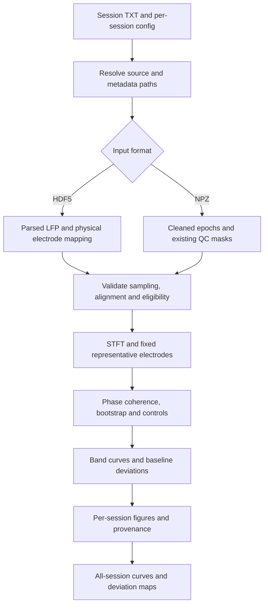

# Figure 6: Mahmood 2023 phase-coherence workflow

This is the preferred LFP figure workflow. `coupling-phase-figure` implements the
phase-coherence analysis in [Mahmood et al. (2023)](https://doi.org/10.1523/JNEUROSCI.1412-22.2022)
and the supplied [lfp_phase_coherence repository](https://github.com/abuzarmahmood/Mahmood_2023_BLA_GC/tree/9c54acb57e227dc9d13597750165b3ebc7be68e9/lfp_phase_coherence).
The executable `updated/lfp_coherence_aggregate.py` and
`updated/lfp_coherence_sig_test.py` are the implementation reference; their README
lists methods not actually used in those scripts. This implementation does not
add Granger, magnitude-squared coherence, multitapers or cluster/FDR tests.

## Quick start

From the repository root:

```bash
python -m pip install -e '.[phase]'
cp configs/fin_inter_list.template.txt configs/fin_inter_list.txt
cp configs/phase_coherence.example.json configs/phase_coherence.local.json
```

Edit both files before running. The template lists three example TG22 session
paths; their presence on your computer has not been verified. Delete unavailable
sessions and add actual TG23/TG24 session directories as additional lines. Do not
put animal parent folders, individual DAT files, quotes or commas in this list.
No trial counts or four-taste assumption are imposed. Only DINs explicitly named
in `stimulus_by_din` are included, so cue DINs cannot silently join the analysis.

In JSON, replace the `REPLACE_ME` preprocessing statement with the actual
filter/reference/extraction/alignment/QC history. The example deliberately fails
until this is done. Confirm 1000 Hz and 2 s prestimulus extraction; `onset_s`
means onset relative to the beginning of the **parsed trial**, not acquisition
clock time. Raw recordings may be 30 kHz; that is not this value.

```bash
coupling-phase-figure configs/fin_inter_list.txt configs/phase_coherence.local.json results/phase_check_01 --check
coupling-phase-figure configs/fin_inter_list.txt configs/phase_coherence.local.json results/phase_run_01
```

Use a new output directory for each invocation. Inspect `status.json` after the
check. Any failed session yields a nonzero exit status; other sessions still run.
`--check` loads and validates the selected LFP data but does not run STFT/bootstrap.

## Where data lives, and where it goes

| Item | Location / meaning |
|---|---|
| `fin_inter_list.txt` | One session directory per line. Absolute paths are portable between working directories. Relative paths resolve against this TXT file, not the shell directory. `~`, environment variables, blank lines and whole-line comments are supported locally. |
| Session source | The original recording/blech_clust session directory, outside this code repository. |
| HDF5 input | Exactly one top-level `.h5` or `.hdf5`, or an explicit per-session `input`. Multiple candidates fail instead of taking the first glob match. |
| Metadata | Exactly one top-level `.info`, or explicit `info`. `electrode_layout` maps physical electrodes to regions, including nested CAR groups. |
| Parsed LFP | `/Parsed_LFP/dig_in_N_LFPs`: **channel × trial × sample**. `/Parsed_LFP_channels`: physical electrode IDs in the exact row order. Row 32 is not automatically electrode 32. |
| Eligible electrodes | `/unit_descriptor/electrode_number`, restricted to `single_unit` if present, or explicit reviewed `eligible_electrode_ids`. The presence of parsed LFP alone does not establish paper-style channel eligibility. |
| Existing STFT/coherence cache | Source `/stft` is never reused or modified; this avoids stale parameters, missing phase nodes, and the reference loader's implicit writes. STFT is recalculated from parsed LFP. |
| Alternative input | Explicit path to this project's `cleaned_lfp.npz`, even when stored under a previous batch's `results/<session>/prepared/`. The session list still names original session folders. |
| Run output | The CLI output path (relative to shell working directory), required to be outside all listed session folders. |
| Per-session output | `<output>/<session-basename>-<path-hash>/`; identical basenames on different drives cannot collide. |

Source HDF5 is opened read-only. No raw extraction, automatic move, copy, source
cache replacement or source write occurs. Unlike the upstream scripts, results
are **not inserted into the session HDF5**. The supplied upstream plot scripts
therefore cannot read these result files unchanged; use this project's plotting
command. This is estimator/input-layout compatibility, not a claim of identical
on-disk output schema.

### Explicit per-session locations

`defaults` merge shallowly with each `sessions` entry. Session keys resolve
relative to the JSON file; use absolute keys to avoid ambiguity. `input` and
`info` resolve relative to that session directory. A configured session absent
from the TXT list is an error (catches stale/mistyped paths).

```json
{
  "defaults": {},
  "sessions": {
    "/media/thomas/Data/TG22/Feb2_OrthoRetro_TG22_260202_170014": {
      "animal_id": "TG22",
      "input": "/home/thomas/intercortical-coupling/results/batch_01/Feb2_OrthoRetro_TG22_260202_170014/prepared/cleaned_lfp.npz"
    }
  }
}
```

For HDF5, keep the example defaults and override `input`, `info`, `region_keys`,
`stimulus_by_din`, `onset_s` or eligibility separately for sessions that differ.
`region_keys` uses exact keys, e.g. `{"GC":"gc","PC":"pc"}`; specify `pp` or
`pPC` only if that is the actual key. Unmapped or multiply mapped electrodes fail.
NPZ uses its embedded mapping/time vector/QC/provenance instead of these HDF5
settings. Existing NPZ validation requires this project's six named conditions.

If a folder contains only `amp-*.dat`, `board-DIN-*.dat`, `.info` and layout CSVs,
it is a **raw recording**, not a parsed HDF5 input. Either perform the established
blech_clust LFP extraction first, or run the existing `coupling-prepare` and point
the config at its returned `cleaned_lfp.npz` path. Do not rename raw files to HDF5.
The legacy preparer applies its own QC/reference/filtering: that is not an exact
reproduction of the paper's second-order 1–300 Hz extraction. Record differences;
this workflow cannot undo a previously applied CAR, notch or high-pass filter.

## Methods and explicit paper/code differences

Default `--profile repository` follows the executable reference. `--profile paper`
changes the documented settings below. Neither profile certifies the upstream
preprocessing or reproduces the original BLA–GC biological experiment in GC–PC.

| Choice | Repository profile | Paper profile |
|---|---|---|
| Estimator | `abs(mean(exp(1j * (phase_GC-phase_PC)), trials))` | Same |
| STFT | Hann, 500 samples at 1 kHz; 499 overlap (1 ms step) | 495 overlap (99%, 5 ms step) |
| Channel selection | Minimum summed absolute error from arithmetic regional mean phase | Minimum summed squared error from arithmetic regional mean phase |
| Bands (Hz, lower inclusive/upper exclusive) | 3–8, 8–13, 13–30, 30–70, 70–100 | 1–4, 4–8, 8–13, 12–30, 30–100 |
| Bootstrap | 500 replacement resamples of matched trial pairs | Same |
| Shuffle | Resample GC trials with replacement against unchanged PC trials | Same repository control |
| Intra-region | One seeded random pair per region, fixed across time/frequency/trials | Same repository control |

STFT reproduces the inspected [`blech_clust/utils/ephys_data/ephys_data.py`](https://github.com/abuzarmahmood/blech_clust/blob/6ceb470ad57446712bc49bf874a743428954b9da/utils/ephys_data/ephys_data.py)
`calc_stft`: linear detrend of each epoch, SciPy zero boundary and padding,
frequency <100 Hz, first 5 s of each snippet (or available duration if shorter).
Time is converted using the declared onset, never unconditionally subtracting
2 s. The transform has 2 Hz frequency spacing, so nominal band edges are not
independent 1 Hz estimates. Near-epoch-edge estimates include padding. The two
profiles intentionally retain the reference's arithmetic treatment of phase in
channel selection rather than silently substituting circular statistics.

All selected stimuli are pooled, including different modalities. This matches
the reference's trial pooling; it is **not an ortho-versus-retro contrast**.
Unequal trial counts weight conditions unequally. The command reports counts.
A representative channel is fixed per region for the whole analysis. At least
two eligible channels per region are required for the intra-region controls.
For NPZ input, events must pass QC on **all eligible channels** before channel
selection; no rejected event is reintroduced. HDF5 input assumes parsed trials
have already been reviewed; it does not invent artifact rejection or laser masks.
If optogenetic conditions must be separated, prepare separate reviewed inputs.

Band averaging follows coherence calculation (not phase averaging). Baseline
bounds are the 2.5/97.5 percentiles pooled over bootstrap draws and time in
(-750, -250) ms. A deviation is a bootstrap-mean curve outside those bounds.
Runs shorter than 100 ms are removed using actual time spacing; opposite signs
are separate runs and a final run is retained. These fix the original script's
sample-count assumption and terminal-run bug. This is the reference's baseline
criterion, **not a cluster-corrected p-value or familywise significance test**.

Two channel-selection STFT passes avoid keeping all channel phases in RAM;
selected/control phases still require substantial memory on large sessions.
Bootstrap arrays are reduced to bands as they are generated, avoiding three
500 × frequency × time caches. Randomness is reproducible from `--seed` and the
resolved session path; moving a session changes its random stream. Numerical
results need not match an unseeded historical run bit-for-bit.

## Outputs

- `manifest_resolved.json`: all session locations and resolved configuration.
- `fin_inter_list.txt`: exported absolute paths, no comments/blank lines, usable
  with the original scripts after updating their hard-coded list location.
- `status.json`: success/failure, actual input path, retained trial counts,
  eligible physical IDs, animal labels and output locations.
- Each session: `phase_coherence.npz` (frequency-time observed coherence, band
  bootstrap/shuffle/intra draws, baseline limits/deviations, selected physical
  IDs, event/stimulus labels); PNG/PDF phase curves and descriptive power context;
  `provenance.json` (input SHA256, source paths, preprocessing declaration,
  reference commit, implementation/module hash, seed and settings).
- `aggregate.npz` and `all_sessions.png/.pdf`: each completed session's band curves,
  baseline-deviation map and fraction of sessions deviating. No silent resampling
  occurs: mismatched time grids stop aggregate generation while preserving
  individual outputs. Failed sessions remain recorded and are excluded.

Power context uses the coherence-selected electrodes, squared STFT magnitude,
trial mean, then temporal z-score for each frequency (not baseline z-score or
calibrated PSD). It is descriptive. No inferential error bars are placed on the
aggregate: sessions are not independent animals. Animal IDs are metadata only.

## Figure flow



## Legacy commands

`coupling-lfp-figure` and `coupling-batch run` retain their historical A–D
power/magnitude-squared-coherence/Granger behavior for reproducibility. They do
not invoke this paper workflow. Use `coupling-phase-figure` for the new Figure 6.
Old results are not relabeled or overwritten. The former figure contract is
archived at `figures/fig06_lfp_coupling/legacy_A_D.md`.
