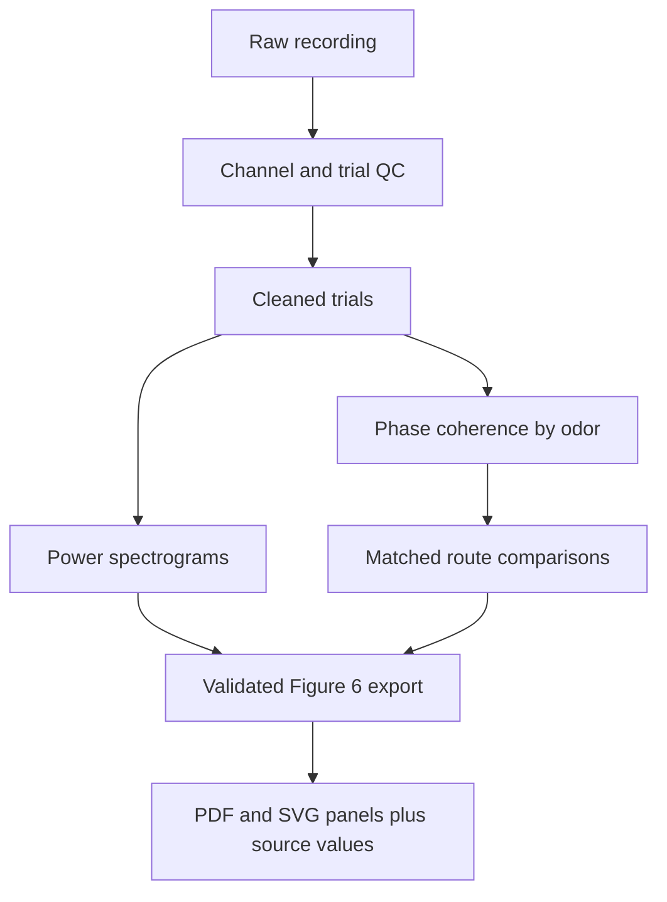

# Figure 6 — LFP power and GC–PC coupling

Clean panel exports are produced here with `coupling-export-figure6`.
The default destination is `figures/fig06_lfp_coupling/exports`; use
`--output figures/fig06_lfp_coupling/exports_SESSION_RUN` for multiple sessions/runs.
Run from the repository root. Generated exports are ignored by Git; source code and
figure instructions remain tracked.

See the [phase workflow and batch export commands](../../lfp_phase_coherence/README.md)
and [power workflow](../../lfp_power/README.md).

| Input | Clean panels |
| --- | --- |
| `session_power.npz` + sibling `provenance.json` | GC/PC × BA/IA × ortho/retro baseline-z power spectrograms |
| Completed phase session with `conditions.json` | Matched-odor and equal-odor route coherence maps, ortho-minus-retro maps, band traces with pointwise 95% bootstrap intervals |

Each panel is saved as editable-text SVG, embedded-font PDF and 300 dpi PNG.
Heatmaps are rasterized inside vector files to keep file size manageable. Fonts are
7–8 pt, axes compact, route colors fixed (blue ortho, orange retro), and decorative
supertitles removed. These are assembly-ready components inspired by Mahmood's
spectrogram/band-trace presentation, not a claim of exact published figure replication
or Current Biology production compliance. Final panel lettering and layout remain an
assembly step. Keep source values and `manifest.json` with the assembled figure.

No biological results are included in this code change. Export actual completed runs;
synthetic validation output must never be used as study data. Inspect upstream QC and
provenance before selecting panels. Session bootstrap intervals do not establish an
animal-level route effect. See [legacy A–D plan](legacy_A_D.md) for MSC/Granger diagnostics.

