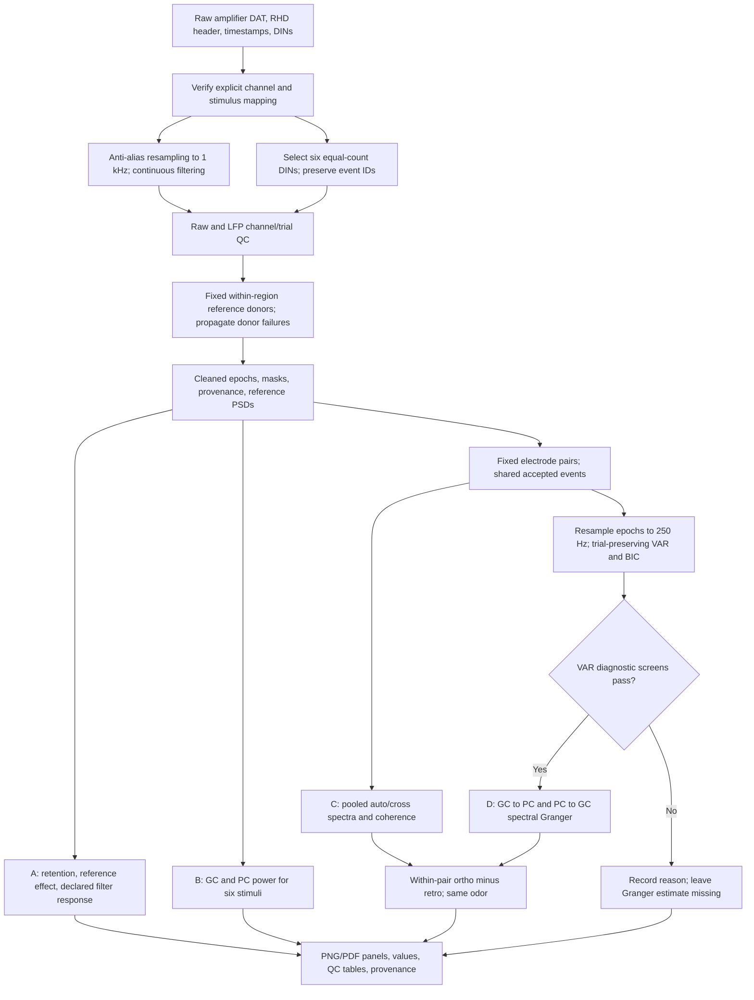
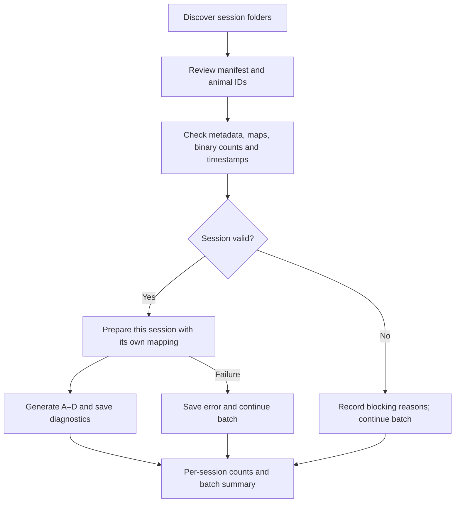

# Figure 6 — LFP power and GC–PC coupling

Implemented command: `coupling-lfp-figure`. Outputs are **descriptive single-session
estimates**, not population inference. Raw sources remain read-only.

## Run on a session

From the repository root, install with `python -m pip install -e .`. Verify the
channel/DIN mapping, animal/session IDs and reference groups in the config first.
The example assigns channels explicitly; do not infer regions from sorted units.

```bash
coupling-prepare /path/to/recording configs/tg22_feb2.example.json results/session_prepared
coupling-lfp-figure results/session_prepared/cleaned_lfp.npz \
  results/session_run/fig06_lfp_coupling \
  --config configs/tg22_feb2.example.json
```

Use a **new output folder** for each run. An existing cleaned archive can be used
if it meets [the data contract](../../docs/data_contract.md) and contains unique
original `event_id` values. Older archives without reference PSD diagnostics still
run, but Panel A explicitly labels those diagnostics unavailable. Re-preparing
adds measured reference diagnostics. Optional existing spectrogram command:

```bash
coupling-power results/session_prepared/cleaned_lfp.npz results/session_run/power_spectrograms
```

## Processing flowchart



## Panels and estimators

| Panel | Contents | Estimator / safeguards |
|---|---|---|
| A | Channel-event acceptance, stimulus retention, measured unreferenced/referenced PSD, declared filter response | Upstream QC masks remain authoritative. The reference comparison uses identical accepted epochs after identical filtering. Filter curve is theoretical forward-backward amplitude gain, excluding resampling; it is not evidence of actual noise removal. |
| B | GC/PC × BA, IA, S, oBA, oIA, BK pre/post PSD | Hann Welch, 500 ms segments, 50% overlap, constant detrending, density in µV²/Hz. Equal accepted trials within channel, then equal accepted channels. All accepted channels are used. |
| C | Pre/post GC–PC magnitude-squared coherence; trial-shift control; matched-odor route differences | Pool auto/cross spectra across trials before `abs(mean(Pxy))² / (mean(Pxx) mean(Pyy))`. Never average trialwise coherence. |
| D | Pre/post GC→PC and PC→GC bivariate spectral Granger; diagnostic retention; matched-odor route differences | OLS ensemble VAR, BIC order choice, Geweke spectral decomposition accounting for correlated innovations. Invalid fits remain NaN, never zero. |

Both analysis windows are 1.5 s: pre **[-1.75, -0.25)** and post
**[0.25, 1.75)** relative to the archive's alignment event. Power/coherence frequency
spacing is 2 Hz, plotted through 80 Hz. Granger is evaluated on a 1 Hz model grid;
this does not imply 1 Hz independent spectral resolution. These are provisional
windows, not an optimized biological choice. This command preserves the archive's
alignment; it does not infer odor arrival from TTL or pressure.

Coupling uses up to five accepted channels per region (`--max-channels`), selected
by ascending physical electrode ID, fixed across stimuli and windows. This is
reproducible and does not select channels for high observed coupling. Each GC–PC
pair uses the intersection of its two QC masks, with at least five trials per
stimulus (`--min-trials`, minimum allowed three). No condition is shortened to a
common trial count. Channel count limits can differ after upstream rejection;
retention and exact pair identities are saved. **Do not average all regional
mean-CAR channels into a single trace: their sum is zero by construction.**

Default matched pairs are **BA vs oBA** and **IA vs oIA**, interpreted as
`[retro, ortho]`. Configure `matched_pairs` in JSON to override. S and BK appear
as context conditions, but are not treated as matched odors. A route difference
is ortho minus retro within each electrode pair, followed by equal-pair averaging.
Only pairs valid for both routes contribute to that window/direction. Counts are
saved at every frequency. Pair composition can differ across windows; a separate
pre-to-post inferential comparison is not implemented.

### Granger diagnostics and limitations

The full epochs are polyphase-resampled to 250 Hz before cropping. Trials are
separately demeaned, and the two channels are scaled for numerical conditioning.
Lagged design rows and residual correlations **never cross trial boundaries**.
Candidate orders default to 2, 5, 10, 15, 20 (8–80 ms); a config `orders` list can
override them. BIC candidates use the same target samples, starting at maximum
order, and require more than ten observations per regressor. The implementation
is bivariate GC, not multivariate GC conditional on respiration or other electrodes.

Each pair/stimulus/window exports selected order, BIC, companion spectral radius,
design condition number, residual multivariate portmanteau p-value (asymptotic
chi-square approximation), largest residual correlation, median within-trial
half-window variance ratio and standardized mean shift. Fits fail when:

- Spectral radius ≥1, rank deficient, or inadequate sample count.
- Design or innovation covariance condition number exceeds 1e8.
- Approximate residual whiteness p<0.01.
- Median half-window variance ratio exceeds 4, or median mean shift exceeds 1 SD.
- Spectral factorization yields invalid/nonpositive power.

An order at the upper search bound is flagged for review. Whiteness screening is
not a calibrated significance test for coupling; stationarity screens do not
prove stationarity. Strong temporal filtering and the 60 Hz notch can cause VAR
misfit. If most models fail, inspect diagnostics and compare justified filter,
reference and order settings; do not disable screens to obtain a positive plot.
The 1 Hz high-pass and 60 Hz notch regions need special caution in interpretation.

The C trial-shift curve cyclically shifts PC trials by one within stimulus. It
is a descriptive trial-locked control, not a permutation confidence interval or
significance threshold. Unequal retained trial counts can bias coherence
comparisons; report counts and use independent session/animal replication before
inference. To assess trial-locked responses, run `--remove-evoked` into a new
folder; it subtracts each channel's within-stimulus trial-average waveform for
coupling (power remains total power). This changes the estimand and is a
sensitivity analysis, not automatic removal of all stimulus confounds.

Shared reference, volume conduction, respiration, nonstationary evoked responses,
filtering and unobserved inputs can produce apparent coupling/directionality.
Granger here describes predictive dependence, **not anatomical direction or
causal intervention**. No electrode-pair error bars, p-values or animal-level
claims are manufactured from one session. Methods reference:
[Barnett & Seth, MVGC toolbox (2014)](https://pubmed.ncbi.nlm.nih.gov/24200508/),
with [author documentation](https://users.sussex.ac.uk/~lionelb/MVGC/html/mvgc_demo.html).
This Python implementation is not the MVGC toolbox itself.

## Output contract

Under `results/<run>/fig06_lfp_coupling/`:

- `A_qc`, `B_power`, `C_coherence`, `D_granger`: each PNG and PDF.
- `plotted_values.npz`: channel PSD, pairwise coherence/Granger, controls, route
  differences and contributing counts; named frequency/window/direction/stimulus
  coordinates, event/electrode IDs, masks and animal/session IDs.
- `reference_filter_diagnostics.npz`: measured reference PSDs and declared filter
  amplitude response where available (absent keys mean unavailable).
- `retention.csv`: channel × stimulus accepted/total counts and coupling selection.
- `pair_event_qc.csv`: original event IDs and pair-specific shared acceptance.
- `granger_diagnostics.csv`: all attempted fits and failure reasons.
- `provenance.json`: input SHA256, source revision, upstream reference/filter/QC
  declarations and complete analysis settings.

Upstream `channel_qc.csv` and `trial_qc.csv` retain the detailed exclusion reasons.
The final figure code does not overwrite or reinterpret these decisions.

## Reproducible validation

```bash
OPENBLAS_NUM_THREADS=1 python -m unittest discover -s tests -v
OPENBLAS_NUM_THREADS=1 python scripts/demo_lfp_coupling.py results/synthetic_fig06
```

The seeded synthetic demo produces all four panels and is conspicuously labeled
**SYNTHETIC VALIDATION**. Tests cover known direction, channel reversal,
independent signals, correlated instantaneous innovations, trial-boundary
separation, coherence bounds, rejected/nonfinite data and common-pair route
contrasts. Synthetic success does not validate anatomical mapping or model
adequacy in a real recording.

### Validation outcome (2026-10-13)

All 31 tests passed in the final suite.
The 1 kHz seeded VAR demo, including the production 250 Hz resampling step,
retained **2/12** pair-window models with the default order grid. An explicitly
separate **10–30 lag sensitivity** retained **10/12**, with the same diagnostic
thresholds. Both outcomes are retained by the demo script: this is a demonstration
of filter/model-order sensitivity, not selection of a preferred biological result.
The known unidirectional process is recovered in accepted fits. Do not infer
adequacy for real recordings from this example.

No real-session Figure 6 result is claimed: the available uploaded inputs include
two amplifier channels and derived power/pressure archives, but no cleaned LFP
archive or full regional reference donor set for this workflow.

## Batch processing

Use [`coupling-batch`](../../docs/batch_sessions.md) for multiple raw session
folders. Each session is checked against its own `.info`, CSV, RHD and binaries,
then receives an independent A–D output directory and provenance.


