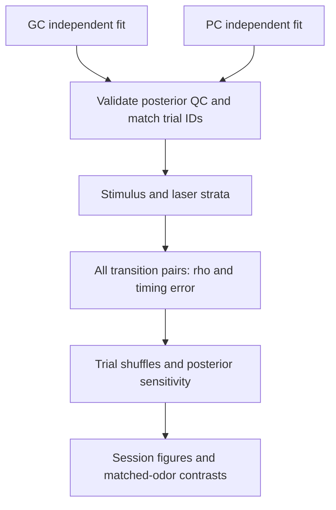

# Population transition coupling

## Panels

A: state/posterior examples. B: matched GC-PC transition timing per trial. C: route comparison against within-condition shuffled-trial nulls.

## Required inputs

Joint trial IDs and independently assessed GC/PC state posteriors.

## Interpretation and validation

Do not align both areas to the same inferred transition and then interpret induced alignment as coupling. Carry state uncertainty; control shared stimulus/respiration timing.

## Output contract

Save panel PNG/PDF, plotted values, counts/exclusions, configuration and source revision under `results/<run>/fig07_transition_coupling/`. Panel letters are provisional. No synthetic output may be labeled as study data.

## Implemented Mahmood-style workflow

See [methods, input contracts and commands](../../docs/mahmood_spike_transition.md).
`coupling-transition-corr` requires existing independent fits; it does not
fit states or infer their biological identity.

