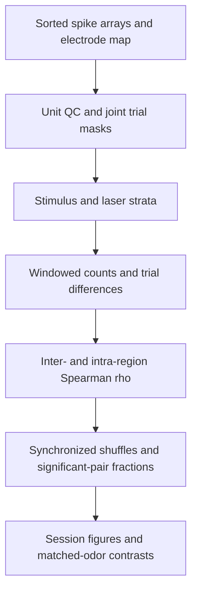

# Single-neuron coupling

## Panels

A: trial-to-trial rate correlations. B: cross-correlograms with appropriate shuffle/jitter controls. C: cross-validated Poisson GLM coupling in each direction. D: overlap of influential units across routes.

## Required inputs

Paired GC/PC spike trains, nuisance regressors, masks, stable within-session unit identity.

## Interpretation and validation

GLMs include own-history, stimulus/time and breathing terms; compare with/without other-region predictors on held-out data. Use regularization, multiplicity control and count-matched sensitivity. Unit identities are not assumed stable between sessions.

## Output contract

Save panel PNG/PDF, plotted values, counts/exclusions, configuration and source revision under `results/<run>/fig08_spike_coupling/`. Panel letters are provisional. No synthetic output may be labeled as study data.

## Implemented Mahmood-style workflow

See [methods, input contracts and commands](../../docs/mahmood_repository_parity.md).
`coupling-spike-noise` implements noise correlations only; cross-correlograms
and GLMs above remain planned.

